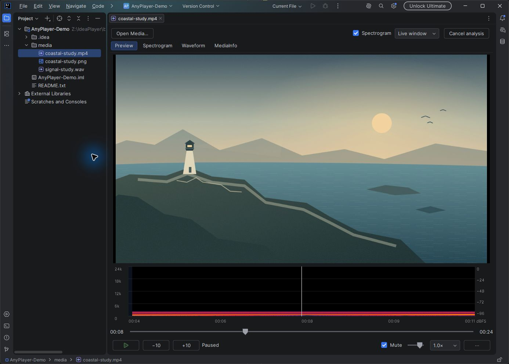
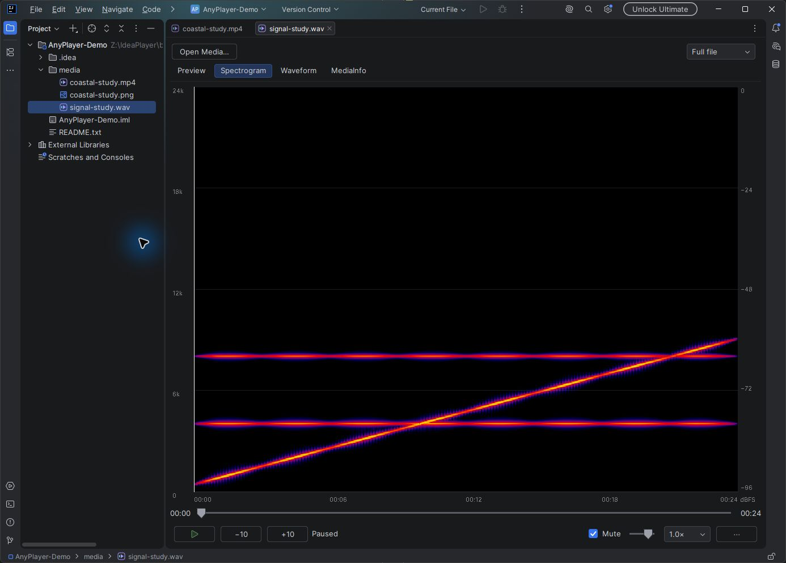
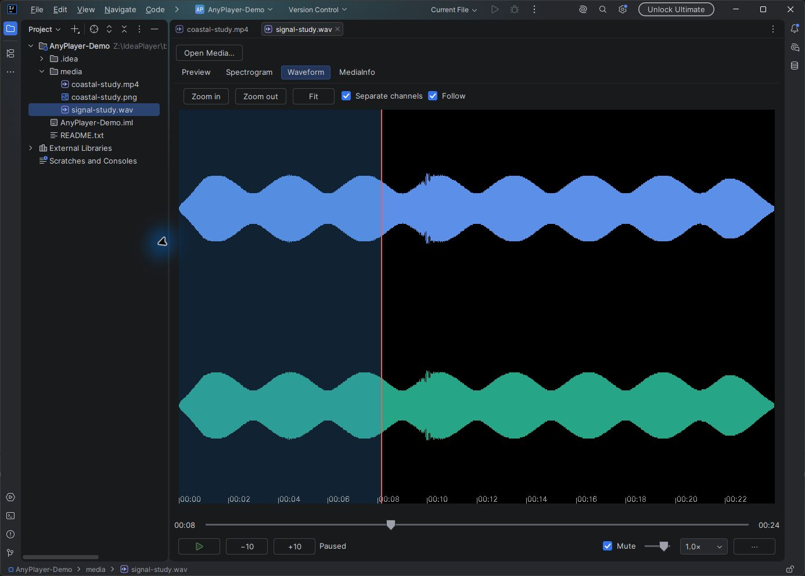
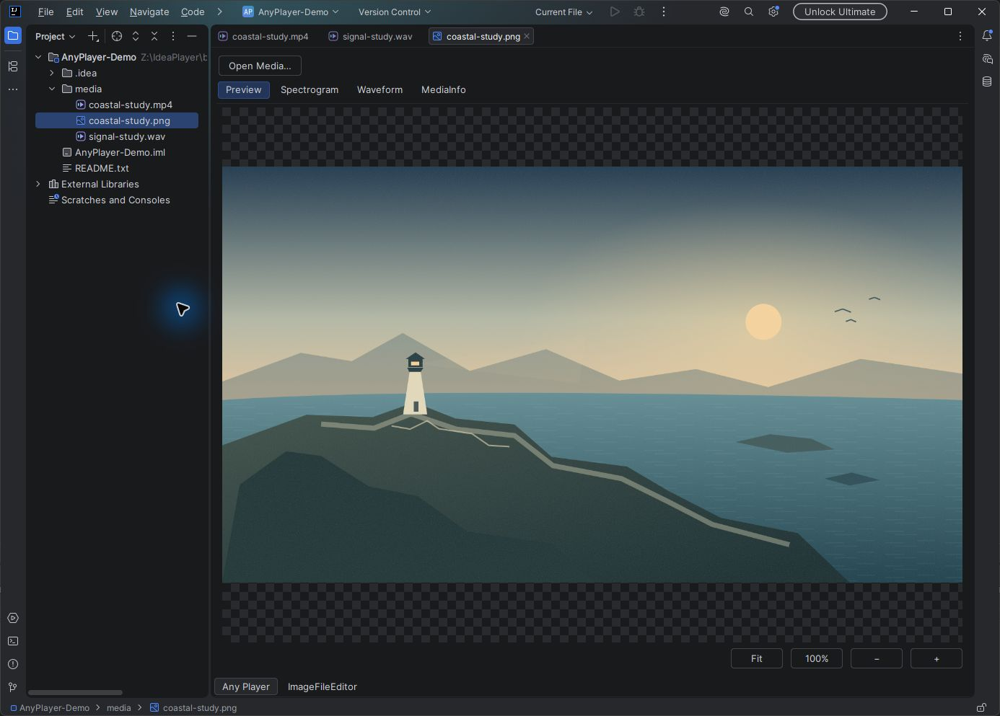

# Any Player

A free, open-source video player, audio player and image viewer for JetBrains IDEs. Publisher: [Romanovsky](https://plugins.jetbrains.com/vendor/Romanovsky). Source: [FrostBy/AnyPlayer](https://github.com/FrostBy/AnyPlayer).

## Screenshots

Actual Any Player running in a clean IntelliJ IDEA 2026.1 sandbox with original demonstration media.



<details>
<summary>Audio spectrum, waveform and image viewing</summary>







</details>

The same image files are ready for the Marketplace Media gallery; see [capture details and upload steps](docs/screenshots/README.md).

## Installation

The current tested release targets **Windows x64, IntelliJ Platform 2026.1 (261)**. Additional platform packages are being prepared. Download the platform-specific installer from [GitHub Releases](https://github.com/FrostBy/AnyPlayer/releases). The generic Java-only ZIP is not an installation package.

Install `AnyPlayer-0.1.0-windows-x86_64.zip` through **Settings → Plugins → gear menu → Install Plugin from Disk**, then restart the IDE. Use **Tools → Open Media…** for a direct HTTP(S) URL or local file path, or open a supported file in the project. Explicit local opening also accepts transport streams (`.ts`) and files without a recognized extension; ordinary TypeScript files keep their normal editor.

- Video/audio: play, pause, seek, speed, volume, audio/subtitle tracks, background playback while coding.
- Images: fit, zoom, pan and transparency; animated GIF/WebP/APNG also support seeking and frame stepping.
- Spectrogram: Live window centers the cursor with decoded upcoming audio on the right; Full file shows the whole source. Both analyze the selected source audio before mute/volume.
- Waveform: zoom, scroll, drag-to-seek and separate channels; volume, mute, speed and analysis/view preferences survive IDE restarts.
- MediaInfo: structured properties, full report and copying.

Click the timeline to jump directly to the pointer, or drag and release to seek. At EOF the thumb reaches the right edge and current time equals total time; Play restarts the file from zero. The `−10` / `+10` buttons seek ten seconds; animations instead show `−1 frame` / `+1 frame`. The speed selector uses `×` units. The track/subtitle menu is prepared before transport is enabled; Refresh tracks reloads it when needed. The English `.ignore` editing notice gains a close button inside Any Player.

Click the video to play or pause, including a paused still shown after seeking. Hover over a seekable video/animation timeline for a thumbnail and timestamp. Dragging pauses audible playback and updates the main still frame before release; release restores the previous playing/paused state. `Left` / `Right` match the visible step buttons, and `Ctrl+Left` / `Ctrl+Right` inspect adjacent video/animation frames on pause. Native control navigation and text-entry shortcuts remain scoped to their focused widgets.

Ready storyboard images appear immediately when cached. After a short hover, an independent decoder refines a four-second neighborhood around the pointer at 0.1-second intervals; seeking also primes this neighborhood. Five nearby thumbnails with timestamps let you inspect by hovering and seek by clicking, without shifting the strip under the pointer. Approximate previews carry `≈`; exact source-frame inspection remains available through `Ctrl+Left` / `Ctrl+Right`. Moving within the prepared window reuses frames rather than restarting a decoder for every pointer movement.

Coarse local storyboards are reused from the IDE system cache and invalidated when a source changes. URL previews are generated in small ranges and retained for the session. Local refinement has its own queue and does not wait for the full storyboard. These thumbnails stay in the popup: the main video retains its last good frame until a matching display-resolution still is decoded, up to 4K, with the same fit and black letterboxing. A single in-flight still request follows the latest target without restarting a pointer-silence debounce.

Narrow editors move volume, speed and secondary settings into `⋯`. Volume changes show a percentage; status distinguishes opening, buffering, seeking and failure. Click the current time or use `Ctrl+G` for **Go to time**. Analysis views have **Cancel analysis / Resume analysis**; waveform **Follow** keeps the playhead visible and manual scrolling turns following off.

Graph cursors and scrolling interpolate between VLC time events with an approximately 60Hz presentation target. Pause and buffering freeze the presentation clock. Waveform Follow slides through prefetched source-time data and retains a valid image while another range is prepared; FFT data generation remains 15fps. These are presentation targets, not a hardware performance guarantee.

Buttons use a hand cursor when enabled. The ignored-file notice also offers **Don't show again**, persisted for Any Player without changing the IDE's ignore settings. The viewer can operate while the IDE indexes the project.

Video-only files disable Spectrogram, Waveform, volume and mute with a no-audio-track explanation. Enabled tabs, graphs and scrollbar controls use hand cursors; disabled tabs and controls retain the default cursor.

Large still images use a bounded Fit preview; 100% and panning request original pixels for the visible region. Region errors are explicit, and viewport output is limited to 16 megapixels. Some native codecs still decode a complete source frame internally. Archive resources stay with their existing IDE viewers. Local rename/move refreshes the source session and retains its position and playing/paused state. Disabling audio clears prior-track spectrograms; mute keeps source analysis active. Waveforms stream PCM into fixed-size envelope accumulators, including short 8 kHz intervals.

## Development

Use the Gradle wrapper with a JDK 21 or newer. The IntelliJ SDK supplies the runtime used by the sandbox. Preparing the Windows native bundle also needs PowerShell and 7-Zip on the developer machine; users do not need system media utilities.

```powershell
powershell -File scripts/prepare-native.ps1
.\gradlew.bat test nativeTest buildPluginVariants_windows_x86_64
.\gradlew.bat runIde
.\gradlew.bat verifyPlugin
```

To reuse an installed IDE instead of downloading the SDK, append `'-PlocalIdePath=C:\Program Files\JetBrains\IntelliJ IDEA 2026.1'`. `test` runs JUnit/SDK checks; `nativeTest` exercises the prepared native runtime with generated media. `verifyPlugin` checks binary API compatibility. Build only prepared platform variants; the generic ZIP has no native runtime and is not the installation archive.

The plugin uses the IDE's JNA and does not package another copy. Tests use the installed IDE's native-loading restrictions. To check a local seekable video with audio through playback and all three analysis views, run `test` with `'-PmediaFixture=C:\media\sample.mp4'`. The optional check derives seek positions from the actual duration. If no path or required capabilities are supplied, it prints why the fixture check was not run; JUnit3 reports that method as successful, not as a runner-level skipped test. An invalid path fails clearly. Generated tests cover other source types independently.

## Repository

`src/main/kotlin/dev/anyplayer/` contains the editor, playback, analysis, image and media modules. Resources live in `src/main/resources/`, tests in `src/test/kotlin/`, native origins/checksums in `native/`, and preparation scripts in `scripts/`.

- [Implementation status and local validation](docs/testing.md)
- [Owner-managed release checklist](docs/release.md)
- [Interactive UI studies and moodboard](docs/design/index.html) (design references, not installed-plugin screenshots)
- [Technical design](openspec/changes/anyplayer-v1/design.md) and [implementation checklist](openspec/changes/anyplayer-v1/tasks.md)

## License

Any Player is licensed under [GNU GPLv3](LICENSE). Bundled dependencies retain their own notices; see [native runtime preparation](native/README.md). Dependency source archives and complete redistribution materials remain part of public release preparation.

Waveform timeline interaction is adapted from Masaki Aida's [Audio Player v1.2.1](https://github.com/aida0710/jetbrains-audio-player-plugin/tree/v1.2.1), under the [retained MIT license](src/main/resources/META-INF/licenses/audio-player-MIT.txt). Its persistent-settings and channel-view features also informed this implementation. Playback remains on libVLC.
