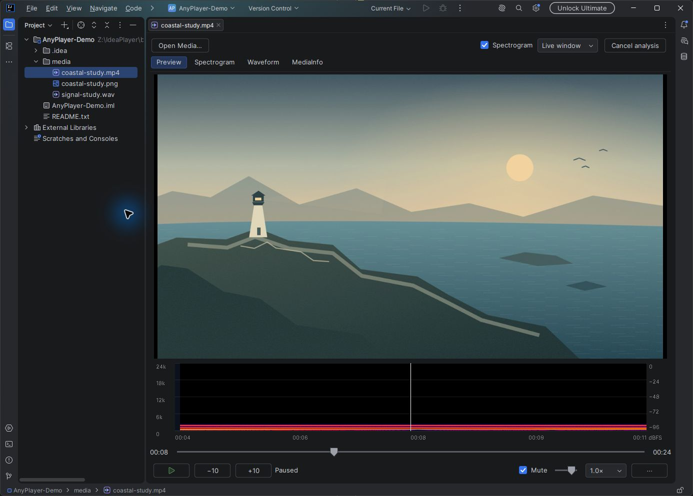
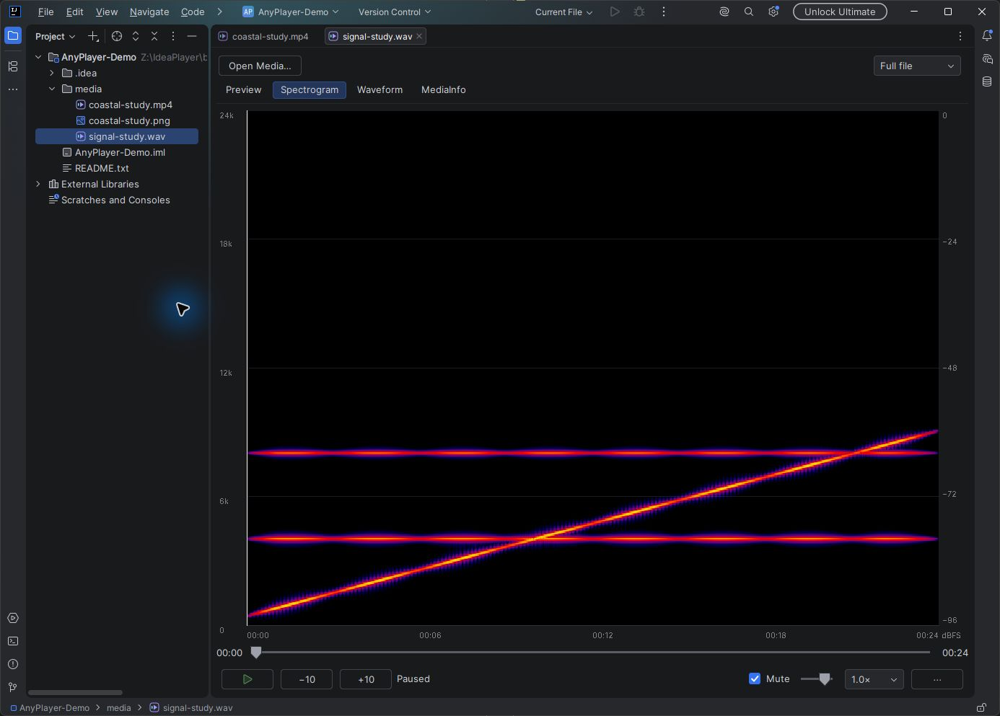
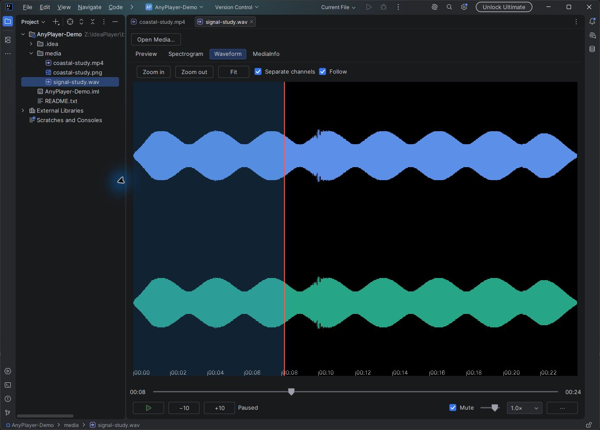
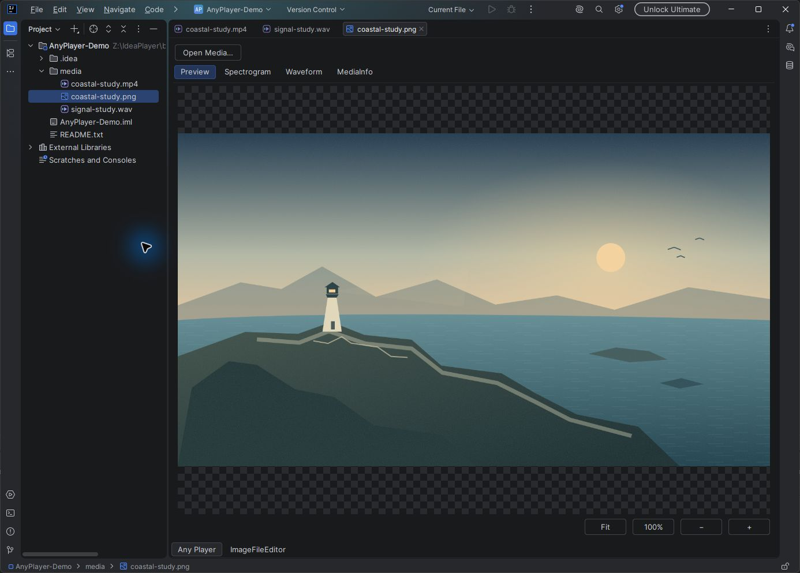

# Any Player

[English](README.md) | **Русский**

[](https://plugins.jetbrains.com/plugin/35683-any-player)

Бесплатный видеоплеер, аудиоплеер и просмотрщик изображений для IDE JetBrains с открытым исходным кодом. Издатель: [Romanovsky](https://plugins.jetbrains.com/vendor/Romanovsky).



<details>
<summary>Анализ аудио и просмотр изображений</summary>







</details>

## Установка

Установите [Any Player из JetBrains Marketplace](https://plugins.jetbrains.com/plugin/35683-any-player) либо откройте **Settings > Plugins > Marketplace**, найдите **Any Player** от **Romanovsky** и установите плагин. Перезапустите IDE, если она предложит это сделать.

Минимальная версия — **IntelliJ Platform 2026.1 (261)**. Верхняя граница версии в архивах не задана; конкретные результаты проверок приведены в [testing.md](docs/testing.md). ID плагина: `me.romanovsky.anyplayer`.

Для ручной установки скачайте подходящий ZIP из [GitHub Releases](https://github.com/FrostBy/AnyPlayer/releases/tag/v0.1.0).

| Операционная система | Архитектуры |
| --- | --- |
| Windows | x86_64, ARM64 |
| macOS | Intel x86_64, Apple Silicon ARM64 |
| Linux | x86_64, ARM64 |

Выбирайте архитектуру запущенной IDE. Например, для Windows x64 нужен `AnyPlayer-0.1.0-windows-x86_64.zip`. Каждый установочный архив содержит свой медиадвижок; отдельно устанавливать VLC, FFmpeg или MediaInfo не требуется.

При переходе со старой версии с другим Plugin ID удалите прежнюю копию. Для установки ZIP откройте **Settings > Plugins > меню с шестерёнкой > Install Plugin from Disk**, выберите архив и перезапустите IDE. Общая Java-сборка без native-компонентов не является установочным пакетом.

## Возможности

- Воспроизведение видео и аудио с перемоткой, скоростью, громкостью, выбором аудио- и субтитровых дорожек. Аудио продолжает играть при переходе к коду.
- Локальные файлы и прямые HTTP(S)-ссылки через **Tools > Open Media…**, включая внешние пути, транспортные потоки и файлы без расширения при явном открытии.
- Изображения с вписыванием в окно, просмотром исходных пикселей, масштабированием, перемещением и прозрачностью. GIF, APNG и анимированный WebP поддерживают перемотку, покадровое управление и повтор.
- Спектрограммы Live и Full file, вейвформа с масштабированием, Follow и раздельными каналами. Анализ исходной дорожки не зависит от громкости и mute.
- Свойства MediaInfo, полные отчёты и копирование. Настройки воспроизведения и просмотра сохраняются между запусками IDE.

## Управление

Клик по видео переключает воспроизведение и паузу. Клик или перетаскивание ползунка переводит на нужное время; наведение показывает кадры с таймкодами. При перетаскивании основной кадр обновляется на паузе, а после отпускания восстанавливается прежнее состояние. Play после конца файла запускает его с начала.

| Действие | Клавиша или элемент |
| --- | --- |
| Воспроизведение / пауза | Space или клик по видео |
| Назад / вперёд | Left / Right или кнопки −10 / +10 |
| Соседние кадры | Ctrl+Left / Ctrl+Right |
| Переход к таймкоду | Ctrl+G или клик по текущему времени |

Горячие клавиши действуют в контексте медиаредактора. Анимации используют шаг в кадрах. В узком редакторе дополнительные действия находятся в `⋯`; у файлов без аудио анализ звука недоступен с пояснением причины.

## Разработка

Используйте JDK 21+ и Gradle wrapper. Сначала подготовьте [native-компоненты](native/README.md) для нужной платформы. Для Windows x64:

```powershell
powershell -File scripts/prepare-native.ps1
.\gradlew.bat test nativeTest
.\gradlew.bat buildPluginVariants_windows_x86_64 verifyPlugin
.\gradlew.bat runIde
```

В macOS/Linux используйте `./gradlew` и задачу соответствующего варианта. [Native CI](.github/workflows/native-packages.yml) проверяет распакованные установочные ZIP на раннерах нужной ОС и архитектуры.

- [Проверки и оставшиеся ограничения](docs/testing.md)
- [Выпуск и ручная загрузка в Marketplace](docs/release.md)
- [Скриншоты и происхождение демонстрационных материалов](docs/screenshots/README.md)
- [Архитектура](openspec/changes/anyplayer-v1/design.md) и [правила для участников](AGENTS.md)
- [Визуальные референсы в браузере](docs/design/README.md)

## Лицензия

Any Player распространяется под [GNU GPLv3](LICENSE). Уведомления о зависимостях, перечень собранных исходников и незавершённые сопоставления внешних библиотек и сборок находятся в [THIRD_PARTY_NOTICES.md](THIRD_PARTY_NOTICES.md).

Управление таймлайном вейвформы использует код [Audio Player 1.2.1](https://github.com/aida0710/jetbrains-audio-player-plugin/tree/v1.2.1) Масаки Аиды с [сохранённой лицензией MIT](src/main/resources/META-INF/licenses/audio-player-MIT.txt).
